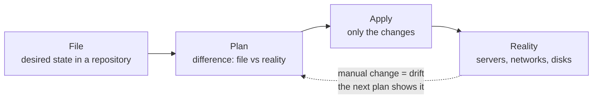
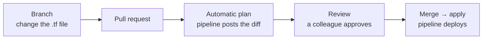

# Session 7 — Infrastructure as Code

**Cloud Computing (Przetwarzanie danych w chmurze), SGH Warsaw School of Economics**
Managing the cloud with bash, Python and declarative templates on AWS, Azure and Google Cloud

> Kubernetes and container orchestration are covered in a separate session. This one stays with the foundations: servers, networks, storage, and the code that manages them.

---

## What you will be able to do after this session

1. Explain why building infrastructure by clicking in a console stops working as a company grows, and what **desired state** and **idempotency** mean.
2. Drive AWS, Azure and Google Cloud from **bash** and **Python**, and know where scripts stop being the right tool.
3. Read **CloudFormation**, **Bicep** and **Terraform** templates and predict what they will change before they change it.
4. Choose an IaC tool for a team and defend it against the classic traps: **drift**, **leaked secrets** and a large **blast radius**.

If you remember only one sentence from today, make it this one:

> **Describe the state, not the steps.**

---

## Contents

1. [A story to start: one typo, four hours without the internet](#1-a-story-to-start-one-typo-four-hours-without-the-internet)
2. [Why clicking does not scale](#2-why-clicking-does-not-scale)
3. [The core idea: imperative vs declarative](#3-the-core-idea-imperative-vs-declarative)
4. [Programmatic control: CLI, bash and Python](#4-programmatic-control-cli-bash-and-python)
5. [Native declarative templates](#5-native-declarative-templates)
6. [Terraform and OpenTofu](#6-terraform-and-opentofu)
7. [How teams actually work with IaC](#7-how-teams-actually-work-with-iac)
8. [Exercises](#8-exercises)
9. [Try it yourself in AWS Academy Learner Lab](#9-try-it-yourself-in-aws-academy-learner-lab)
10. [Glossary](#10-glossary)
11. [Self-check questions](#11-self-check-questions)
12. [Further reading](#12-further-reading)

---

## 1. A story to start: one typo, four hours without the internet

On **28 February 2017**, an AWS engineer was investigating a problem with the billing system of **Amazon S3**, the storage service where a large part of the internet keeps its files. Following an established playbook, the engineer typed a command by hand to take a small number of servers out of service.

One input parameter was wrong. The command removed a much larger set of servers, including those running two core S3 subsystems: the **index** (which knows where every object lives) and the **placement** system (which decides where new objects go). S3 in the **US-EAST-1** region stopped working for about **four hours**. Websites, apps and even smart-home devices that quietly depended on S3 stopped responding. Ironically, the AWS status dashboard also depended on S3, so for a while it could not even report the outage.

Why four hours? S3 had grown enormously, and those subsystems had not been fully restarted in years. Nobody knew how long a full restart would take at that scale, because nobody had done one.

Two lessons:

- **This was not a bad engineer.** It was a manual operation with no safety net. AWS's fix was not "be more careful": they changed the tool so that it removes capacity more slowly and refuses to go below a safe minimum. In other words, they **put the rules into code**.
- **A process you never run, you don't really know.**

Think about it: if you were the engineer's manager, what would you change so it could never happen again? Typical good answers are a second pair of eyes, a dry run before the real change, limits on what one command can do, automation, and a history of changes. Every one of them is a feature of Infrastructure as Code. You will meet each of them again below.

---

## 2. Why clicking does not scale

Building infrastructure by clicking in a console, or by typing commands by hand, has three weaknesses:

| Weakness | What it means in practice |
| --- | --- |
| **It does not scale** | Configuring one machine by hand takes ten minutes. A thousand machines is not a plan, it is a lottery: somewhere you will click something slightly differently. |
| **It is not repeatable** | Test and production environments built by hand almost never end up identical. This is called **configuration drift**, and it is behind many "but it worked in testing" incidents. |
| **It is not auditable** | Six months later someone asks who opened this port and why. With clicking there is no good answer. With a file in a Git repository you look at the history. |

**Example.** A bank has a test and a production environment. During a night-time incident, someone opens a firewall port in production to fix the problem quickly. Nobody adds that rule to test. Three months later a new release passes every test and fails in production, because production is no longer the system the tests ran against.

**Pets vs cattle.** The old way treats servers as *pets*: each has a name, is set up by hand and nursed back to health when sick. The new way treats them as *cattle*: numbered, identical and replaced from the same description when one fails. You can only treat servers as cattle if that description exists, in code.

---

## 3. The core idea: imperative vs declarative

There are two ways to tell a computer what you want.

| | Imperative | Declarative (IaC) |
| --- | --- | --- |
| You describe | the **steps**, in a fixed order | the **target state** |
| Example | "Create a machine, then a disk, attach it, then open port 443…" | "I want 3 machines, one load balancer, port 443 open." |
| Run it twice | the result may differ | same result |
| Typical tools | clicking, bash scripts, single CLI commands | CloudFormation, Bicep, Terraform |

With the declarative approach, the tool compares what you asked for with what exists, works out the difference and closes it. This is called **reconciliation**.

**Analogy: a taxi.** Imperative is telling the driver every turn. Declarative is giving the address. If a road is closed, the driver with the address takes a detour; the driver with your list of turns is stuck.

**You already know a declarative language: SQL.** `SELECT name FROM customers WHERE city = 'Warsaw'` describes the result, not which index to use or in which order to read data. The query optimiser decides how. IaC applies the same thinking to servers.

### The loop that explains every tool



- **File**: your desired state, kept in Git.
- **Plan**: the tool compares the file with reality and shows the difference.
- **Apply**: the tool makes only those changes.
- **Reality**: the actual resources in the cloud.
- **Drift**: someone changes something by hand. The next plan notices and shows it.

Example: the file says three web servers. If one crashed and was deleted, the plan says *1 to add*. If someone added a fourth by hand, the plan says *1 to destroy*, and a human decides whether that was a mistake or whether the file should say four. Either way, **nothing changes silently**.

CloudFormation, Bicep and Terraform are all this loop with different names on the boxes.

### Idempotency: run it twice

| | Run 1 | Run 2 | Result |
| --- | --- | --- | --- |
| `aws ec2 run-instances ... --count 1` | creates a machine | creates **another** machine | 2 machines, 2 bills |
| `terraform apply` | `Plan: 1 to add` | `No changes.` | 1 machine |

**Idempotent** means that running something again gives the same result. It is what makes automation safe: if you can run something a hundred times without fear, you can put it in a pipeline.

Everyday examples: pressing a lift call button five times still brings one lift (idempotent). The "buy now" button in an online shop is not, which is why payment systems send an **idempotency key** with each payment to avoid charging you twice.

Back to the S3 story: a tool that knows the target state ("at least N servers") can refuse a dangerous change. A tool that only knows "remove these servers" cannot.

---

## 4. Programmatic control: CLI, bash and Python

### Same task, three clouds

Create one small Linux VM from the command line:

```bash
# AWS CLI
aws ec2 run-instances \
  --image-id ami-0abc... --instance-type t3.micro \
  --region eu-central-1

# Azure CLI
az vm create -g rg-sgh -n vm-dev \
  --image Ubuntu2204 --size Standard_B1s \
  --location polandcentral --generate-ssh-keys

# Google Cloud CLI
gcloud compute instances create vm-dev \
  --machine-type=e2-micro --zone=europe-central2-a \
  --image-family=debian-12 --image-project=debian-cloud
```

Don't memorise the commands; notice the pattern: **noun + verb + parameters**. Once you know one CLI, the others feel familiar quickly.

More important is **where a resource lives**, because it decides who can see it, who pays for it and how easily you can clean up:

| Cloud | Unit of organisation |
| --- | --- |
| AWS | account + region |
| Azure | subscription + resource group (deleting a resource group deletes everything in it) |
| Google Cloud | project + zone |

`europe-central2` (Google) and `polandcentral` (Azure) are both in Warsaw. AWS does not yet have a full region in Poland, so Frankfurt (`eu-central-1`) is the usual choice.

**Practical notes**

- Every CLI must know who you are: `aws configure`, `az login`, `gcloud auth login`. In each provider's **Cloud Shell** (a terminal in the browser) this is done for you.
- **Never paste access keys into a script.** That is how they end up on GitHub.
- All three CLIs can return JSON or tables and filter output (on AWS: `--query`). That is what makes a CLI scriptable.

### Automation step 1: a bash loop

```bash
#!/usr/bin/env bash
set -euo pipefail

for env in dev staging prod; do
  gcloud compute instances \
    create "vm-$env" \
    --zone=europe-central2-a \
    --machine-type=e2-micro \
    --labels=env=$env
done
```

`set -euo pipefail` stops the script at the first error and treats undefined variables as errors.

- **Good:** fast to write; dev, staging and prod get the same parameters.
- **The catch:** run it again tomorrow. On Google Cloud, machine names must be unique, so the first command fails with `vm-dev already exists` and the script stops halfway. On **AWS** names are just tags, so the same script **silently creates duplicates**, which is arguably worse.

You could add checks before every command (does it exist? right size? right labels? stopped?), but the ten-line script quickly becomes two hundred lines: a small, buggy re-implementation of Terraform. That is usually when teams switch tools.

**The script knows steps, not state.**

### Automation step 2: Python SDKs

When you need real logic (conditions, loops over data, reacting to what you find), use an SDK. This script stops every running machine tagged `env=dev`, for example every evening:

```python
import boto3

ec2 = boto3.client("ec2", region_name="eu-central-1")
res = ec2.describe_instances(Filters=[
    {"Name": "tag:env", "Values": ["dev"]},
    {"Name": "instance-state-name", "Values": ["running"]}])

ids = [i["InstanceId"]
       for r in res["Reservations"]
       for i in r["Instances"]]
if ids:
    ec2.stop_instances(InstanceIds=ids)
print("Stopped:", ids)
```

Why this matters: a dev machine is used maybe 50 hours a week, but a week has 168. Machines left running overnight and at weekends are one of the most common cloud cost leaks (more in Session 14). Note that the script **only works because machines are tagged**. Without consistent tagging it is blind.

| Cloud | Python library |
| --- | --- |
| AWS | `boto3` |
| Azure | `azure-identity` + `azure-mgmt-compute` |
| Google Cloud | `google-cloud-compute` |

The same code can run on a schedule without a server, as an AWS Lambda, Azure Function or Cloud Run job.

> **Key insight:** the console, the CLI, the SDK and Terraform are not four different ways of talking to the cloud. They are four front ends to the same thing: the provider's **API**. Everything in the cloud is an API call, which is why everything in the cloud can be automated.

**Python is good for** scheduled clean-ups, cost reports, reacting to events and connecting systems. **It is not good for** describing your whole infrastructure; you would end up rewriting Terraform by hand.

### Is a bash script in Git already "Infrastructure as Code"?

| What it has | What it lacks |
| --- | --- |
| It is code, versioned in a repository | No knowledge of current state, only steps |
| It can be reviewed in a pull request | Not idempotent unless you hand-write every check |
| It automates the clicking | Cannot detect drift or show a plan before acting |

**Verdict: it is automation, not IaC.**

> **IaC = code + desired state + a tool that reconciles reality with it.**

Scripts remain excellent for **operations** (stopping machines at night, reports, one-off fixes). The **infrastructure itself** is owned by templates.

**Related tools:** Ansible, Chef and Puppet are *configuration management* tools. Terraform and CloudFormation create the machine; configuration management sets up what runs inside it (packages, config files, users). Many companies use both.

---

## 5. Native declarative templates

Every cloud offers two layers: a CLI for quick imperative operations, and a declarative template language for whole environments.

| | CLI (imperative) | Declarative template | Preview before change |
| --- | --- | --- | --- |
| AWS | AWS CLI | CloudFormation (YAML / JSON) | change sets |
| Azure | Azure CLI | ARM templates (JSON) → Bicep | what-if |
| Google Cloud | gcloud CLI | Infrastructure Manager (Terraform); Deployment Manager reached end of support | terraform plan |

The last column is the **dry run**: every serious tool shows you the plan before it touches anything.

**When to choose a native tool:** if you are all-in on one cloud. New services are often supported on day one, the tool is free and supported by the provider, and on AWS and Azure the provider tracks what was deployed, so there is no separate state file to look after. The price: your skills and code stay tied to one cloud.

### AWS CloudFormation

```yaml
AWSTemplateFormatVersion: "2010-09-09"
Resources:
  WebServer:
    Type: AWS::EC2::Instance
    Properties:
      InstanceType: t3.micro
      ImageId: ami-0abc1234def567890
      Tags:
        - Key: env
          Value: dev
```

Notice what is missing: no "create", no "then", no order. Only **what**, never **how**.

- **Stack**: all resources from one template are created, updated and deleted together.
- **Change set**: before an update, see exactly what will be added, modified or **replaced**. Watch the word *Replace*.
- **Drift detection**: compares the stack with reality and lists manual changes.
- **Delete the stack**: everything it created goes away in one step, with no forgotten resources.
- CloudFormation keeps the stack's state inside AWS and, by default, **rolls back** a failed deployment to the last working version.

Deploy: `aws cloudformation deploy --template-file web.yaml --stack-name web-dev`

### Azure: ARM templates and Bicep

**ARM templates** are the native JSON format of Azure Resource Manager: complete but verbose. **Bicep** is a cleaner language that **compiles down to ARM JSON**. It is not a new engine, just a friendlier face on the same one, and Microsoft recommends it over hand-written ARM.

```bicep
param location string = resourceGroup().location

resource sa 'Microsoft.Storage/storageAccounts@2023-05-01' = {
  name: 'sgh${uniqueString(resourceGroup().id)}'
  location: location
  sku: { name: 'Standard_LRS' }
  kind: 'StorageV2'
}
```

- Preview: `az deployment group what-if -g rg-sgh --template-file main.bicep`
- Deploy: `az deployment group create -g rg-sgh --template-file main.bicep`
- See the generated ARM JSON: `az bicep build --file main.bicep`
- Bicep supports **modules**, so a team can write "our standard storage account" once (with encryption and logging) and everyone reuses it.
- For clean-up, put a whole environment in one **resource group**; deleting the group deletes everything in it.

### Google Cloud: the native tool was retired

Google's native tool, **Cloud Deployment Manager** (YAML plus Jinja or Python templates), **reached end of support on 31 March 2026**. Resources created with it keep running, but the tool is no longer supported. Google points users to **Infrastructure Manager**, a managed service that runs **Terraform** for you, including state, logs and permissions.

One of the three largest cloud providers decided its own template language was not worth maintaining and adopted the multi-cloud standard. For companies with hundreds of Deployment Manager configurations, this was a real migration project with a deadline, people and budget. That is a risk of any vendor-specific tool: **the vendor decides how long it lives**.

---

## 6. Terraform and OpenTofu

### One language, many providers

**Terraform** (HashiCorp, 2014) is the most widely used tool for describing infrastructure across clouds.

- **HCL**: one declarative language for AWS, Azure, Google Cloud, and also GitHub, Cloudflare, Datadog and hundreds of other platforms.
- **Providers**: plugins that translate HCL into one platform's API calls.
- **State file**: Terraform's own record of what already exists, compared with your code on every plan.
- **Modules**: reusable building blocks (for example "our company's standard network"). Thousands are published in the public Terraform Registry.

```hcl
provider "google" {
  project = "sgh-demo"
  region  = "europe-central2"
}

resource "google_compute_instance" "vm" {
  name         = "vm-dev"
  machine_type = "e2-micro"
  zone         = "europe-central2-a"
  boot_disk {
    initialize_params {
      image = "debian-cloud/debian-12"
    }
  }
  network_interface {
    network = "default"
  }
}
```

`google_compute_instance.vm` is the resource's **address** inside Terraform (type + local name). It is not the machine's name in the cloud; that is the `name` field.

Why teams choose it: **one skill set, one review process, one workflow** across clouds.

### The workflow: four commands

| Command | What it does |
| --- | --- |
| `terraform init` | downloads providers, connects the state backend |
| `terraform plan` | compares code + state + reality, prints the difference |
| `terraform apply` | executes the plan: only the differences |
| `terraform destroy` | removes everything the code created |

Example plan output:

```text
  # google_compute_instance.vm will be created
  + resource "google_compute_instance" "vm" {
      + machine_type = "e2-micro"
      + name         = "vm-dev"
      ...
Plan: 1 to add, 0 to change, 0 to destroy.
```

Plan symbols: `+` create, `~` update in place, `-` destroy, `-/+` **replace** (destroy and recreate; watch for it, just like *Replace* in a CloudFormation change set).

> **Read the last line of every plan.** "0 to destroy" is the sentence that would have saved S3 in 2017. If you expect 0 and see 5, stop.

### The state file: Terraform's memory

- **It can hold secrets.** Passwords and keys may land in `terraform.tfstate` in plain text. **Never commit it to Git.**
- **Two people, one state.** Parallel applies can corrupt it. Use a **remote backend with locking**.
- **Where to keep it:** an S3 bucket, an Azure Storage container or a Google Cloud Storage bucket: encrypted, versioned, access-controlled. (Object storage is Session 8.)
- **Adopting Terraform gradually:** `terraform import` brings existing, hand-built resources under management, so you don't have to delete and recreate them.

**If you lose the state file**, Terraform forgets your infrastructure exists. The next `apply` tries to create everything again: it fails on name conflicts or, worse, succeeds and you have two of everything.

### "Terraform code runs on any cloud." Does it?

```hcl
# AWS
resource "aws_instance" "vm" {
  instance_type = "t3.micro"
  ami           = "ami-0abc..."
}

# Azure
resource "azurerm_linux_virtual_machine" "vm" {
  size = "Standard_B1s"
  # ...
}

# Google Cloud
resource "google_compute_instance" "vm" {
  machine_type = "e2-micro"
  # ...
}
```

**No.** Each cloud has its own resource types, arguments and defaults. What is portable is the **language, the workflow and your skills**, not the code. Moving clouds still means rewriting. Generic "multi-cloud VM" modules work for simple cases, but the abstraction leaks quickly: networking, identity and pricing really differ. **Terraform lowers the cost of lock-in; it does not remove it.**

### The landscape keeps moving

| When | What happened |
| --- | --- |
| 2014 | HashiCorp releases Terraform as open source |
| 2018–2019 | Pulumi and AWS CDK: IaC in general-purpose languages (Python, TypeScript, Go…) |
| August 2023 | Terraform moves to the Business Source License (BSL); the community forks it as **OpenTofu** (Linux Foundation, open source) |
| February 2025 | IBM completes the acquisition of HashiCorp |
| December 2025 | CDK for Terraform is deprecated |
| March 2026 | Google Cloud Deployment Manager reaches end of support |

**IaC in Python.** With Pulumi you might write `aws.ec2.Instance("vm", instance_type="t3.micro")`. You get real loops, functions and tests. The trade-off: more power also means more ways to make a mess. HCL is limited on purpose, which makes it easy for anyone to read.

**Business lesson:** one licence change and one acquisition reshaped a market that thousands of companies depend on. The good news: OpenTofu reads the same HCL and uses the same `init → plan → apply` workflow. **Tools change; the idea stays.**

---

## 7. How teams actually work with IaC

### Nobody clicks in production: changes go through Git



The pipeline, not a person's laptop, runs `apply`. It can also run **policy as code** checks before review: no public storage buckets, every resource must have an owner tag, no oversized machines in dev. Company rules turn from a PDF nobody reads into checks nobody can skip.

Every answer to the S3 question is here: a second pair of eyes (review), a dry run (plan), a record of who changed what (Git history), and limits (only the pipeline may apply).

> **If it's not in the repository, it doesn't exist.**

### Four classic traps

| Trap | What goes wrong | Defence |
| --- | --- | --- |
| **Drift** | "Just this once" fixes in the console that never make it back into code | Read-only console access in production; regular plan / drift checks |
| **Secrets in code** | Passwords in `.tf` files, or state committed to Git. Bots scan public GitHub repositories for cloud keys; leaked keys are often abused within minutes, typically for crypto mining | AWS Secrets Manager, Azure Key Vault, Google Secret Manager; code only references secrets (see Session 5) |
| **Huge blast radius** | One state for everything: one mistake hits everything | Split state per environment and component |
| **Untagged resources** | Nobody knows who owns what or who pays | Mandatory tags (`owner`, `env`, `cost-center`) in every module (see Session 14) |

### Summary in one breath

- **The idea:** describe the state, not the steps.
- **Scripts:** great for operations, but they know steps, not state.
- **Native templates:** the same loop, built by each provider.
- **Terraform / OpenTofu:** one workflow across clouds, with a state file you must guard.
- **Process:** changes go through Git, a plan and a review, never through a click in production.

**Analogy: a recipe vs a chef's memory.** A script is the chef cooking from memory: fine until the chef is ill. A template is the recipe: anyone can cook it, any number of times, and the dish comes out the same. Git is the recipe book, with every edit signed and dated.

---

## 8. Exercises

### Exercise 1: predict what CloudFormation will do

```yaml
Resources:
  WebServer:
    Type: AWS::EC2::Instance
    Properties:
      InstanceType: t3.micro
      ImageId: ami-0abc1234...
```

1. You change `InstanceType` from `t3.micro` to `t3.small` and update the stack. Same machine or a new one?
2. You change `ImageId` instead. What happens?
3. Yesterday someone resized the machine by hand in the console. What will you see?

<details>
<summary>Answers</summary>

1. **Same machine.** It is an update with some interruption: EC2 stops the instance and starts it again with the new type.
2. **Replacement.** The image cannot change on an existing instance, so CloudFormation creates a new instance and deletes the old one. Anything stored on the old machine's disk is lost.
3. **Drift.** The template still says `t3.micro`. Drift detection reports the difference, and the next update may silently revert the manual change.

**Moral:** the change set is your dry run. Always read it, especially the word *Replace*.
</details>

### Exercise 2: three identical environments, zero clicking

A team needs dev, staging and production environments that are guaranteed to be the same. Today they run on AWS; the board is discussing adding Azure next year.

1. Native tool or Terraform/OpenTofu? Defend your choice in one sentence.
2. What exactly guarantees the three environments will **not** drift apart over time?
3. Where does the state live, and who is allowed to run `apply` on production?

<details>
<summary>What a strong answer contains</summary>

1. With Azure on the horizon, Terraform/OpenTofu is the natural choice. "CloudFormation now, because the team knows it" is also defensible. The argument matters more than the tool.
2. One module used three times with three variable files (`dev.tfvars`, `staging.tfvars`, `prod.tfvars`): the same code with different parameters (for example smaller machines in dev). Changes only through pull requests.
3. A remote backend with locking and a separate state per environment. Only the pipeline applies to production; no human runs `apply` on prod from a laptop.
</details>

---

## 9. Try it yourself in AWS Academy Learner Lab

This is the live demo from class. It shows the limits of imperative scripts. Learner Lab only allows the **us-east-1** and **us-west-2** regions, instance sizes from nano to large, and at most **9 instances** running at once per region, so the demo uses `us-east-1` and stays at 8 × `t3.micro`.

> ⚠️ **Always run the clean-up step at the end.** Learner Lab has a limited budget.

**Setup**

```bash
export AWS_DEFAULT_REGION=us-east-1

# latest Amazon Linux 2023 image
export AMI=$(aws ssm get-parameter \
  --name /aws/service/ami-amazon-linux-latest/al2023-ami-kernel-default-x86_64 \
  --query Parameter.Value --output text)

# if ssm returns AccessDenied, use this instead:
# export AMI=$(aws ec2 describe-images --owners amazon \
#   --filters "Name=name,Values=al2023-ami-2023*-x86_64" \
#   --query 'sort_by(Images,&CreationDate)[-1].ImageId' --output text)

# helper: list all demo machines
list() {
  aws ec2 describe-instances \
    --filters "Name=tag:course,Values=sgh-s7" \
              "Name=instance-state-name,Values=pending,running,stopping,stopped" \
    --query 'Reservations[].Instances[].[InstanceId,Tags[?Key==`Name`]|[0].Value,State.Name]' \
    --output table
}
```

**Step 1–2: run the same command twice**

```bash
aws ec2 run-instances --image-id $AMI --instance-type t3.micro --count 1 \
  --tag-specifications 'ResourceType=instance,Tags=[{Key=Name,Value=vm-demo},{Key=course,Value=sgh-s7}]' \
  --query 'Instances[0].InstanceId' --output text
# run it again, then:
list
```

You get **two** machines with the same name. Not idempotent.

**Step 3: the bash loop, twice**

`create-envs.sh`:

```bash
#!/usr/bin/env bash
set -euo pipefail
: "${AMI:?Set the AMI variable first}"

for env in dev staging prod; do
  aws ec2 run-instances \
    --image-id "$AMI" \
    --instance-type t3.micro \
    --count 1 \
    --tag-specifications "ResourceType=instance,Tags=[{Key=Name,Value=vm-$env},{Key=env,Value=$env},{Key=course,Value=sgh-s7}]" \
    --query 'Instances[0].InstanceId' --output text
done
```

```bash
chmod +x create-envs.sh
./create-envs.sh
./create-envs.sh
list
```

On AWS there is no "already exists" error: you get duplicates of everything.

**Step 4: tag and stop dev machines with Python**

```bash
IDS=$(aws ec2 describe-instances \
  --filters "Name=tag:Name,Values=vm-demo" "Name=instance-state-name,Values=running" \
  --query 'Reservations[].Instances[].InstanceId' --output text)
aws ec2 create-tags --resources $IDS --tags Key=env,Value=dev
python3 stop_dev.py
list
```

Use the `stop_dev.py` script from Section 4 with `region_name="us-east-1"`. If `boto3` is missing: `pip install --user boto3`. If the script prints an empty list, the machines are still starting; wait 20 seconds.

**Step 5: clean up (do not skip)**

```bash
IDS=$(aws ec2 describe-instances \
  --filters "Name=tag:course,Values=sgh-s7" \
            "Name=instance-state-name,Values=pending,running,stopping,stopped" \
  --query 'Reservations[].Instances[].InstanceId' --output text)
aws ec2 terminate-instances --instance-ids $IDS \
  --query 'TerminatingInstances[].[InstanceId,CurrentState.Name]' --output table
```

This works only because every machine carries the same `course` tag. Forget it once and something stays on the account, costing money. Finding and deleting resources by hand is exactly the problem templates solve: delete the stack, and everything it created goes away.

**Going further:** write the same environment as a CloudFormation template or a Terraform configuration, deploy it, run the deployment a second time and compare the result with Step 3.

---

## 10. Glossary

| Term | Meaning |
| --- | --- |
| **Infrastructure as Code (IaC)** | Managing infrastructure through code + a desired state + a tool that reconciles reality with it |
| **Imperative** | Describing the steps to perform, in order |
| **Declarative** | Describing the target state; the tool works out the steps |
| **Desired state** | The infrastructure you want, as written in the file |
| **Reconciliation** | Computing the difference between desired state and reality and closing it |
| **Idempotent** | Running it again gives the same result |
| **Configuration drift** | Reality no longer matches the code, usually after manual changes |
| **Stack** (CloudFormation) | All resources created from one template, managed as a unit |
| **Change set / what-if / plan** | A preview of changes before they are applied (AWS / Azure / Terraform) |
| **ARM / Bicep** | Azure's native template formats; Bicep compiles to ARM JSON |
| **HCL** | HashiCorp Configuration Language, used by Terraform and OpenTofu |
| **Provider** | A Terraform plugin that translates HCL into one platform's API calls |
| **State file** | Terraform's record of what it manages (`terraform.tfstate`) |
| **Remote backend** | Shared, locked storage for the state file (S3, Azure Storage, GCS) |
| **Module** | A reusable building block of IaC code |
| **Blast radius** | How much can break as a result of one mistake |
| **Policy as code** | Automatic checks of IaC code against company rules |
| **OpenTofu** | Open-source fork of Terraform, run by the Linux Foundation |

---

## 11. Self-check questions

<details>
<summary>1. What three elements make something Infrastructure as Code rather than just automation?</summary>

Code, a desired state, and a tool that reconciles reality with that state.
</details>

<details>
<summary>2. You run <code>aws ec2 run-instances --count 1</code> twice. How many machines do you have, and why?</summary>

Two. The command means "create one more"; it does not know what already exists, so it is not idempotent.
</details>

<details>
<summary>3. Why does the same bash loop behave differently on Google Cloud and on AWS when run twice?</summary>

Google Cloud requires unique instance names, so the second run fails with "already exists". On AWS the name is only a tag, so the second run silently creates duplicates.
</details>

<details>
<summary>4. What happens if you delete the Terraform state file and run <code>terraform apply</code>?</summary>

Terraform forgets the infrastructure exists and tries to create everything again: it fails on name conflicts or creates duplicates.
</details>

<details>
<summary>5. Which line of a Terraform plan should you always read, and why?</summary>

The last one, e.g. <code>Plan: 1 to add, 0 to change, 0 to destroy.</code> It tells you whether anything will be destroyed. An unexpected number "to destroy" is a reason to stop.
</details>

<details>
<summary>6. Does using Terraform make a company cloud-independent?</summary>

No. Resource types and arguments differ per cloud, so moving still means rewriting code. Terraform makes the language, workflow and skills portable, which lowers the cost of lock-in but does not remove it.
</details>

<details>
<summary>7. Why must the state file never be committed to Git, and where should it be kept?</summary>

It can contain secrets in plain text, and concurrent edits can corrupt it. Keep it in a remote backend with locking (S3, Azure Storage, GCS): encrypted, versioned and access-controlled.
</details>

<details>
<summary>8. When is a native tool (CloudFormation, Bicep) a better choice than Terraform?</summary>

When the company is committed to one cloud: day-one support for new services, provider support, no separate state file to manage. The cost is that code and skills are tied to that cloud.
</details>

<details>
<summary>9. What replaced Google Cloud Deployment Manager, and what does that tell you?</summary>

Infrastructure Manager, a managed service that runs Terraform. It shows that vendor-specific tools can be retired by the vendor and that the industry is converging on Terraform-style workflows.
</details>

<details>
<summary>10. Name the four classic IaC traps and one defence for each.</summary>

Drift (read-only production console, regular plans); secrets in code (secrets manager services); huge blast radius (split state per environment and component); untagged resources (mandatory tags in every module).
</details>

---

## 12. Further reading

**Documentation**

- [AWS CloudFormation User Guide](https://docs.aws.amazon.com/AWSCloudFormation/latest/UserGuide/Welcome.html)
- [Bicep documentation (Microsoft Learn)](https://learn.microsoft.com/azure/azure-resource-manager/bicep/overview)
- [Google Cloud Deployment Manager: end of support](https://docs.cloud.google.com/deployment-manager/docs/support)
- [Terraform documentation](https://developer.hashicorp.com/terraform/docs)
- [OpenTofu documentation](https://opentofu.org/docs/)
- [Boto3 documentation (AWS SDK for Python)](https://boto3.amazonaws.com/v1/documentation/api/latest/index.html)

**Course literature (syllabus)**

- Microsoft (current edition), *Azure Well-Architected Framework*, learn.microsoft.com/azure/well-architected
- Google Cloud, *Google Cloud Architecture Framework*, cloud.google.com/architecture/framework

**Coming up in Session 8:** object storage: Amazon S3 (yes, the same S3 from today's story), Azure Blob Storage and Google Cloud Storage. Something to think about before then: *why don't we keep the Terraform state file on the disk of a virtual machine?*
